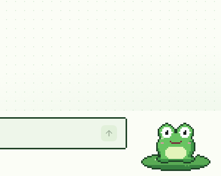
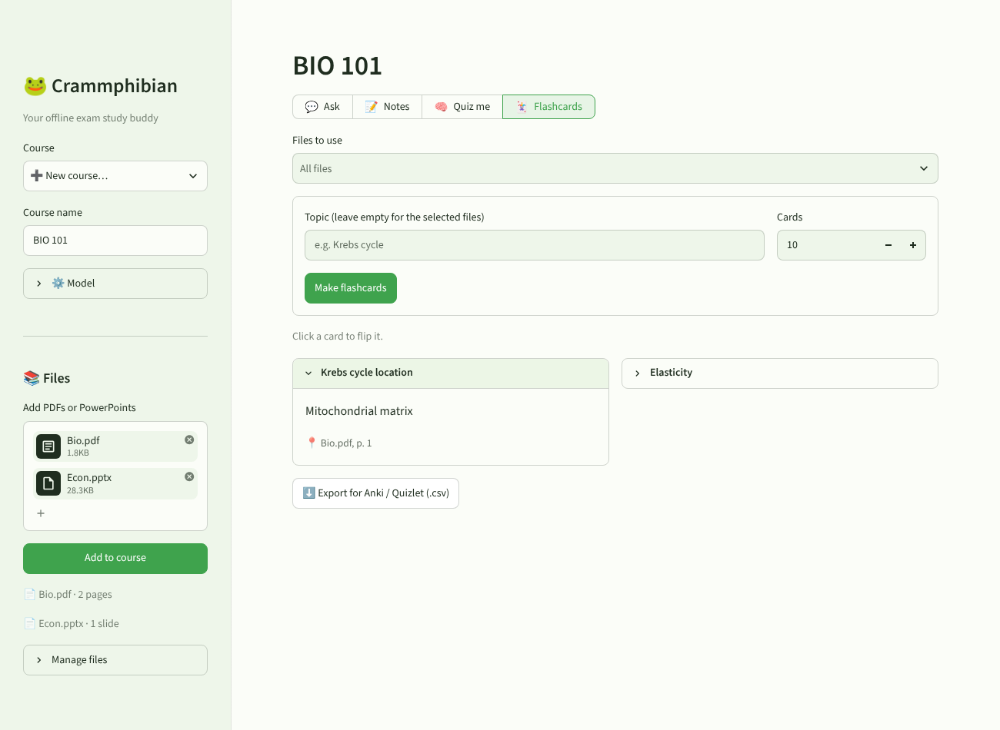
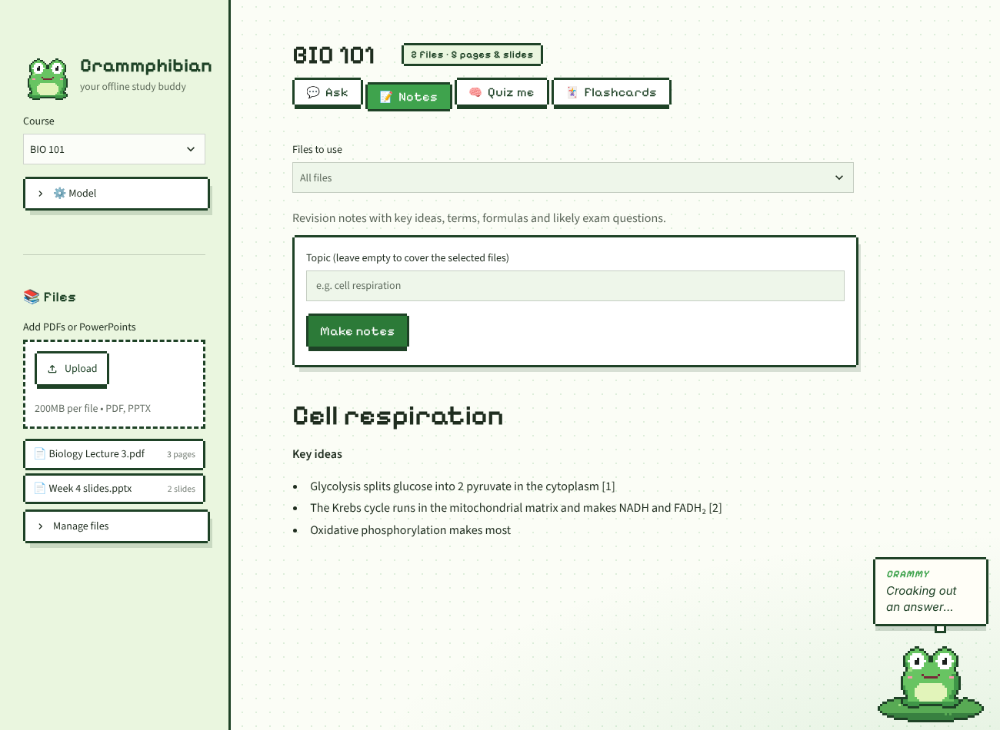
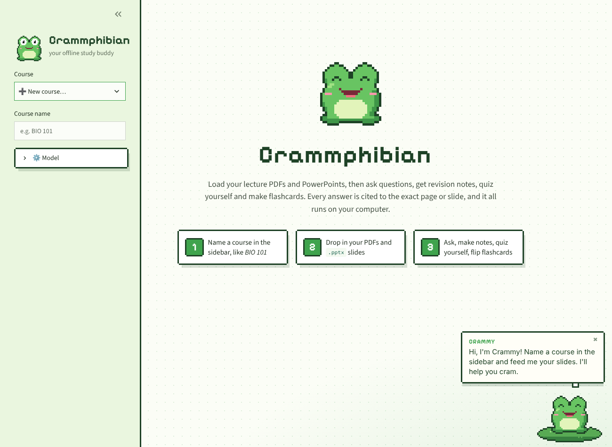

# 🐸 Crammphibian

[](https://github.com/SVishisht/crammphibian/actions/workflows/tests.yml)

**Your offline exam study buddy.** Load all your lecture PDFs and PowerPoint slides,
then ask questions, make revision notes, quiz yourself and build flashcards, every
answer **cited to the exact page or slide**, running entirely on your own computer.


> "Explain the Krebs cycle step by step" → an answer built only from your notes,
> citing *Biology Lecture 3.pdf, p. 2* and *Week 4 slides.pptx, slide 7*.

- **Private and offline.** Your files never leave your laptop. No account, no API key.
- **PDFs and PowerPoints (.pptx)**, including tables and speaker notes.
- **Semantic + keyword search.** Finds passages by meaning *and* by exact terms
  (formula names, acronyms).
- **One course per subject.** Keep BIO 101 and ECON 200 separate; indexes are
  saved, so you only add files once.
- **Four study modes:**
  - 💬 **Ask**: chat with your notes, with follow-up questions
  - 📝 **Notes**: revision notes (key ideas, terms, formulas, likely exam questions), downloadable as Markdown
  - 🧠 **Quiz me**: multiple-choice questions with scoring and the page each answer comes from
  - 🃏 **Flashcards**: flip cards, exportable to Anki or Quizlet (CSV)
- **Search-only mode** to jump straight to the right slide without an AI answer.
- **Runs on modest laptops.** A lite setup needs under 1 GB of RAM.
- **Crammy, your study frog.** A pixel-art frog lives in the corner, gives tips,
  thinks while the model works and cheers your quiz scores. [Meet Crammy ↓](#meet-crammy)

<p align="center"></p>

## Why I built this

I started Crammphibian in my second year. I was juggling a pile of new subjects,
and at the same time I'd just discovered RAG (retrieval-augmented generation) and
couldn't stop thinking about it. So I decided to build a RAG project that wasn't
just a demo, but something that would actually help me get through my own studying.

When I came back to it later, I gave it a fresh coat of paint (and a frog friend)
and put it on GitHub. If you're staring down a stack of slides before an exam,
I hope it helps you the way it helped me. Feel free to use it, share it with your
classmates, or open an issue if something could be better. Happy cramming! 🐸

## Install (about 5 minutes, once)

You need **Python 3.10+** ([download](https://www.python.org/downloads/)) and
**Ollama**, the free app that runs AI models locally ([download](https://ollama.com/download)).
Install both, then download this folder and run:

**macOS / Linux**
```bash
./install.sh
```

**Windows** (PowerShell, inside the folder)
```powershell
powershell -ExecutionPolicy Bypass -File install.ps1
```

The installer creates a private Python environment in `.venv` and downloads two
models (~2.3 GB total, one time): `nomic-embed-text` for search and `llama3.2:3b`
for answers. Needs about 4 GB of free RAM.

**Low on space or RAM?** Use the lite models instead (~450 MB, under 1 GB RAM;
answers are simpler and quizzes less polished):

```bash
./install.sh --lite                                              # macOS / Linux
powershell -ExecutionPolicy Bypass -File install.ps1 -Lite       # Windows
```

## Use

Start it with `./start.sh` (macOS/Linux) or double-click `start.bat` (Windows).
Your browser opens at http://localhost:8501.

1. Type a course name in the sidebar (e.g. *BIO 101*).
2. Drop in your PDFs and `.pptx` files and click **Add to course**.
3. Pick a mode at the top. Use **Files to use** to focus on one lecture.
   Open **Sources** under each answer to see the exact passages.
4. Stuck? Click Crammy, the frog in the bottom-right corner, for a tip.

| Quiz me | Flashcards |
|---|---|
|  |  |
| **Notes** | **Welcome** |
|  |  |

There's also a command line:

```bash
.venv/bin/crammphibian index "BIO 101" lecture1.pdf lecture2.pptx
.venv/bin/crammphibian ask "BIO 101" "What is oxidative phosphorylation?"
```

`cramm` works as a short alias for `crammphibian`.

## Settings

All optional, set as environment variables before starting:

| Variable | Default | What it does |
|---|---|---|
| `CRAMMPHIBIAN_LLM_MODEL` | `llama3.2:3b` | Any Ollama chat model. Use `llama3.1:8b` or `qwen2.5:7b` for better answers if you have 16 GB RAM. You can also switch in the sidebar. |
| `CRAMMPHIBIAN_EMBED_MODEL` | `nomic-embed-text` | Ollama embedding model for new courses. Existing courses keep the model they were built with. |
| `CRAMMPHIBIAN_HOME` | `~/.crammphibian` | Where course indexes are saved. |
| `OLLAMA_HOST` | `http://localhost:11434` | Where Ollama is running. |

**Optional cloud model.** If your laptop is slow, you can have answers written by
an OpenAI model instead: `.venv/bin/pip install -e ".[cloud]"`, set `OPENAI_API_KEY`,
then turn on **Use cloud model** in the sidebar. Search still runs locally, but your
question and the matching excerpts are sent to the API.

## Meet Crammy

Crammy sits on a lily pad in the bottom-right corner, like an old-school desktop
assistant but smaller and greener.

- **Click** for a study tip (tips change with the mode you're in). Click a lot and find out.
- **Hover** and Crammy perks up. **Drag** to move; **double-click** to send it home.
- **Thinks** while your notes are searched and **talks** while an answer streams in.
- **Reacts** to quiz scores, finished notes and flashcards, and errors (e.g. Ollama not running).
- **Dozes off** after a minute of no activity. **Nap** (in the speech bubble) tucks it
  behind the lily pad until you click it.
- **Sound** is off by default; turn on tiny croaks in the speech bubble.
- Respects your system's *reduce motion* setting.


**Use your own frog.** Replace the PNGs in `crammphibian/assets/frog/` (idle, blink,
talk, think, happy, sad, sleep, and optionally lilypad), keeping the file names, then
restart. Pixel art stays crisp; animated GIFs work too. Details in
[`crammphibian/assets/frog/README.md`](crammphibian/assets/frog/README.md).
A square `crammphibian/assets/mascot.png` still works as the logo, tab icon and avatar.

## Limitations (v0.3)

- Old `.ppt` files: save them as `.pptx` or PDF first.
- Scanned PDFs (images of pages) have no text to read; OCR isn't supported yet.
- Diagrams and images aren't understood, only the text on the page or slide.
- Small local models can be slow on older laptops (expect 5–30 s per answer)
  and are less precise than big cloud models. Always check the cited pages.
- With the lite model, quizzes and flashcards sometimes come out malformed; broken
  items are dropped, so you may get fewer than you asked for. Click again or use a bigger model.

## How it works

```
PDF pages / slides ──► text per page/slide ──► ~1000-char chunks
                                                  │
                      ┌───────────────────────────┴──────────────┐
                 FAISS vectors (Ollama embeddings)        BM25 keyword index
                      └──────────── reciprocal rank fusion ──────┘
                                         │
                   top passages, numbered [1]..[n] with file + page/slide
                                         │
                 local LLM (Ollama) via LangChain ──► answer with [n] citations
```

Code: `crammphibian/loaders.py` (PDF/PPTX parsing), `index.py` (hybrid search,
saved per course), `qa.py` (RAG prompt), `study.py` (notes, quizzes, flashcards),
`app.py` (Streamlit UI), `companion.py` + `assets/companion.*` (Crammy), `cli.py`.

## Development

```bash
.venv/bin/pip install -e ".[dev]"
.venv/bin/pytest
```

Tests use stand-in embeddings and a fake chat model, so they run without Ollama.

Credits: pixel font [Pixelify Sans](https://github.com/eifetx/Pixelify-Sans), SIL Open Font License.
